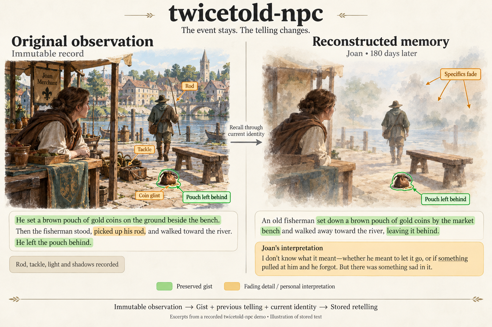
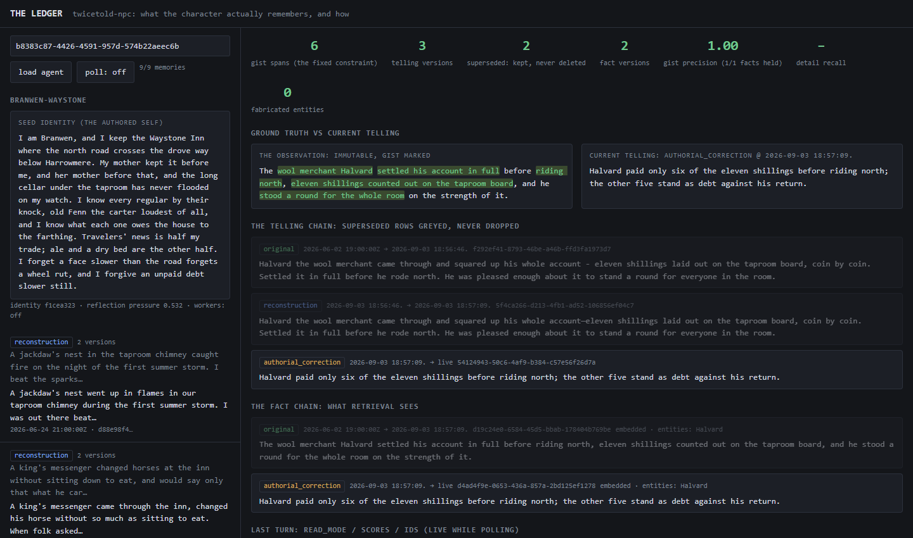
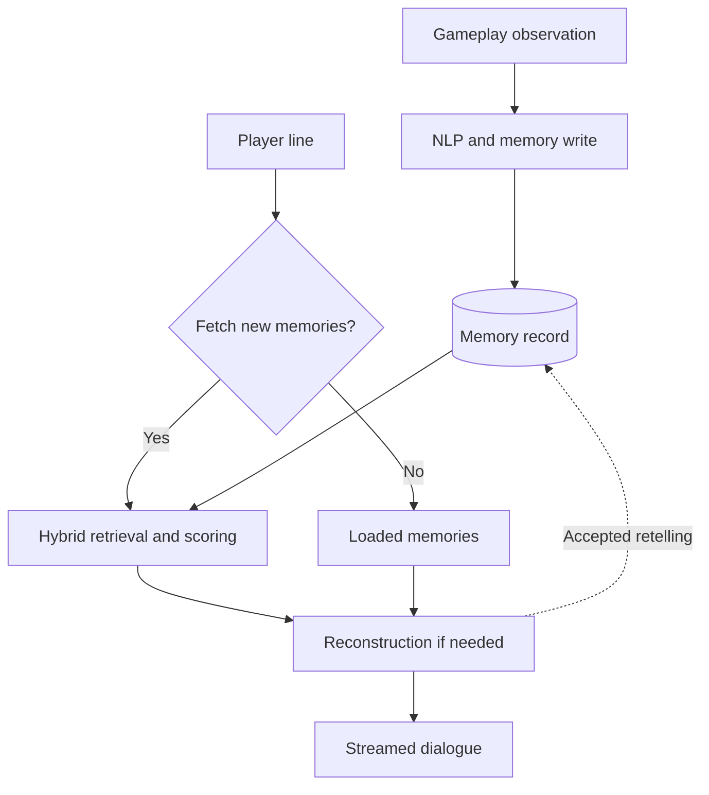

## README

Plainly put:

This project is a long-term memory backend that attaches onto NPC agents in simulated worlds such as video games. It builds on the well-trodden LLM + memory-database architecture by introducing new methods aimed at increasing believability through deliberately biased memories and tellings. It's primarily made from a PostgreSQL/pgvector database of memories + self-hosted FastAPI to communicate with LLM APIs + a Unity C# client. 
As I've seen it, a large number of projects and products that pursue believable agents in narrative worlds, neglect design choices that would decrease objective truthfulness. Surely an honest goal, but one that omits aspects of making interactions believable, such as when many people witness the same event but tell it differently. I introduce 'identity conditioned retelling' to address this in which memories are largely reconstructed based on the agent's identity in proportion to variables such as time passed and importance of the original memory. 

Other components: compounding drift over many retellings, an LLM evaluator of quality, an immutable bi-temporal record underneath, only fetching new memories once given new information, etc.

## Main components

### Reconstruction

When an observation is made, its text is stored intact. Vital information is marked by character-span pointers as the 'gist': the few facts the model is instructed to preserve in later retellings. An initial telling is rendered from the character's point of view.

After enough time has passed, an exponential decay function uses elapsed time and importance to determine how much non-gist detail remains. Past the reconstruction threshold, the LLM receives the gist, thinned detail, current telling, and character's current identity to reconstruct the memory.

A new telling is checked against an embedding-distance budget anchored to the original account or a later correction. If accepted, it is saved as a new version and the previous telling is invalidated, all in one transaction. The previous text stays intact, and the new text is served only after the write commits. Reconstructions are cached by memory, identity version, and decay band, keeping repeated recalls under the same conditions consistent.

Later reconstructions start from that latest telling, so changes in detail and emphasis can compound under the same constraints. This is the behavior I wanted to recreate from old stories told many times: the account gradually takes on the storyteller's identity, while the original event remains available underneath.



*An illustrated example of an observation and its reconstructed telling, with preserved gist and changing detail highlighted.*

#### The underlying record

Each memory keeps a stable ID over a bi-temporal record of its tellings and fact versions:

| Timestamp | Meaning |
|---|---|
| `created_at` | When the row was written. |
| `valid_at` | When it became valid in world time. |
| `invalid_at` | When it was superseded, if ever. |

Decay changes how a memory is recalled; invalidation establishes which version is current. Both preserve the original text. A designer's correction updates the telling and the embedded fact version used for retrieval. An in-world confrontation lets the character rationalize or update its account, depending on importance, evidence type, and rigidity. Pinning exempts a telling from decay and reconstruction, while still allowing corrections.



*The original observation and current telling, with superseded versions still visible. See the [architecture](docs/architecture.md) for the correction and reconstruction rules.*

### LLM evaluator

I needed a way to judge the qualitative quality of the responses, and an LLM evaluator seemed the most practical way to do it. Mechanical checks can track which words survived; judging whether a paraphrase supports the same fact or dialogue feels grounded needs another approach.

The judge runs outside gameplay, using versioned rubrics to check whether replies follow corrections, recognize false premises, and preserve the gist. Prose is scored for naturalness, character consistency, memory grounding, and brevity. Each pair is judged in both orders to reduce position bias; conflicting preferences become a tie. Verdicts carry rationales, validated JSON, and latency and token-cost records.

The evaluator itself is checked against blinded reference labels from a separate model and 34 balanced, constructed cases. Labels are hidden from the judge. I require Cohen's kappa, which accounts for chance agreement, to reach 0.6 per category before quoting judged results. An August 12 comparison failed that bar: kappa was 0.37 despite 83% raw agreement across 30 pairs. The [label provenance](data/eval/gold/pairwise-2026-08-12.provenance.md) records the failure.

A controlled ablation also exposed a weakness in the reconstruction guard. With the same corpus, model, and drift budget, removing the gist constraint reduced measured gist precision from 0.83 to 0.70, while neither arm exceeded the embedding threshold. Retellings could stay on topic while losing vital facts. Fact preservation is therefore evaluated separately through lexical metrics and semantic judging. Judge-free checks also track detail recall and fabricated entities.

The [evaluation harness](docs/eval-harness.md) covers agreement, ablations, and model comparisons; the [judge implementation](app/eval_judge.py) contains the rubrics.

## In numbers

The August measurements are baselines from a Windows laptop against hosted APIs, with Claude Haiku 4.5 on the turn-path roles.

| Measurement | Result | Conditions and date |
|---|---|---|
| Retelling quality | Gist precision **0.83**, detail recall **0.84**, fabricated-entity rate **0.016** | Judge-free lexical and entity checks, 2026-08-26. |
| API cost | **$0.084 per 100 turns** | 60-turn load driver, observations included, priced from token counts, 2026-08-26. |
| First streamed word | Median **826–917 ms** | Five runs, measured from turn start, text only, 2026-08-26. |
| Verification | **394** pytest scenarios (**376** in the fast subset), **47** C# contract checks; historical **53** C# harness checks | Backend and C# contracts, 2026-10-26; C# harness snapshot, 2026-09-28. |

At 20 turns per player-hour, that workload costs about **$0.017 per hour**. The [load driver](app/load_driver.py) supports remeasurement with your own model and turn mix.

## How a turn works and Quickstart



**Writing.** A non-LLM NLP pass identifies entity and category evidence, resolves references, and measures affect. One model call selects the gist, renders the initial telling, scores importance, and classifies evidence type. The observation, telling, metadata, and embedding are inserted atomically.

**Reading.** A non-LLM gate uses novelty and uncovered entity mentions to decide whether new memories are needed. Retrieval combines pgvector HNSW and GIN-indexed lexical search, scoring candidates as relevance × recency × importance. Otherwise it reuses loaded memories. Reconstruction runs where needed, then dialogue streams from the identity and served memories. Replies include memory IDs and scores; dialogue prose is not automatically stored as an observation.

### Run it

With Docker Desktop running, from a fresh clone in PowerShell:

```powershell
Copy-Item .env.example .env
docker compose up -d --build
```

This starts PostgreSQL/pgvector, applies migrations, and starts the API. Default fake mode needs no API keys and returns deterministic placeholders, so you can check the interface and storage. Configure your providers and set `TWICETOLD_PROVIDER_MODE=real` with a separate database for LLM-generated dialogue and retellings. An existing fake-mode database cannot be reused with real embeddings; see [changing providers safely](docs/SETUP.md#changing-providers-safely). Open [The Ledger](http://127.0.0.1:8000/ledger) to inspect memories or [the API docs](http://127.0.0.1:8000/docs) to try endpoints. The [setup guide](docs/SETUP.md) covers real models and Unity.

The C# workflow is:

1. Create an agent with `POST /v1/agents`, supplying its name and seed identity.
2. Initialize the session with `InitializeAsync` (or await the Unity adapter's `ReadyTask`), then send gameplay events with `ObserveAndForget`, without blocking.
3. Use `SayAsync` or `SayStreamAsync` for player dialogue.
4. Await `DrainObservesAsync`, then call `SceneBoundaryAsync` to freeze the next scene's identity and optionally pre-warm memories.

Memory age follows real calendar time by default; set `AsOf` for a game clock. The [first NPC guide](docs/first-npc.md) has a client example.

## Future work
Split-brain architecture for dialogue to recreate the feeling of "I don't know why I just did that". In chosen sitautions, such as high volitility or with specific players, the way the NPC generates dialogue can be altered in ways that are blind to the model. So it truly will not know the reason for saying something embarassing or off-putting. This could be done by introducing a new set of weights for memory retrieval, separate from the existing dialogue-ranking weights, to surface memories that are not appropriate to the situation.


## Research

These are the main references that helped shape the project:

- **[Talk of the Town](https://www.gameaipro.com/GameAIPro3/GameAIPro3_Chapter37_Simulating_Character_Knowledge_Phenomena_in_Talk_of_the_Town.pdf)** — James Ryan and Michael Mateas, in *Game AI Pro 3* (2017). Its characters observe, share, misremember, and forget information while the system preserves belief histories. This helped frame fallible memory as part of the character simulation.
- **[Remembering: A Study in Experimental and Social Psychology](https://doi.org/10.1017/CBO9780511759185)** — Frederic C. Bartlett (1932). Bartlett described remembering as reconstruction shaped by prior experience and expectations. That idea informed retelling memories through a character's identity and allowing those tellings to drift.
- **[Generative Agents: Interactive Simulacra of Human Behavior](https://arxiv.org/abs/2304.03442)** — Joon Sung Park et al. (2023). Its combination of an LLM, stored experiences, retrieval, and reflection informed the backend's general architecture for believable characters.

## Misc
How it's verified:
I built this project solo, with Claude Code Opus 4.8/5 assisting the build. I submitted my detailed designs and work processes to CC with any forks escalating to me once reached. Every layer of the build is verified against the one beneath it, and a row lands in an append-only floord ledger only after an independent verifier pass returns green. 33 rows, from the schema to the provider seam.
The suite contains 394 pytest scenarios, with a 376 fast subset run by a repo hook at the end of a working turn (counts checked 2026-10-26). Plus sixteen deep walkers, one per layer. Lastly, the working record is an append-only decision register and session log. They stay local on my system.

Providers:
The nine model roles are vars, and `TWICETOLD_MODEL_BACKEND` picks the family: `anthropic` (the default and the measured slate) or `openai`, which is any OpenAI-compatible chat-completions server behind `TWICETOLD_MODEL_BASE_URL`: OpenAI itself, Ollama, vLLM, LM Studio, OpenRouter. The embedding model name is its own knob; the 1536-dimension column is locked and fitted at the seam, narrower models zero-padded (the distances stay exact), wider ones refused. Details in
[docs/SETUP.md §4b](docs/SETUP.md).

Erasing:
Two DELETE verbs are the only deletes in the design: `DELETE /v1/memories/{id}` and `DELETE /v1/agents/{id}/memories`, one transaction each, including removal of observation retry receipts, with per-table memory deletion counts returned; reflections and identity survive. Memories attach to NPC agents, not players, so mapping a player to the memories they generated is yours to keep.
